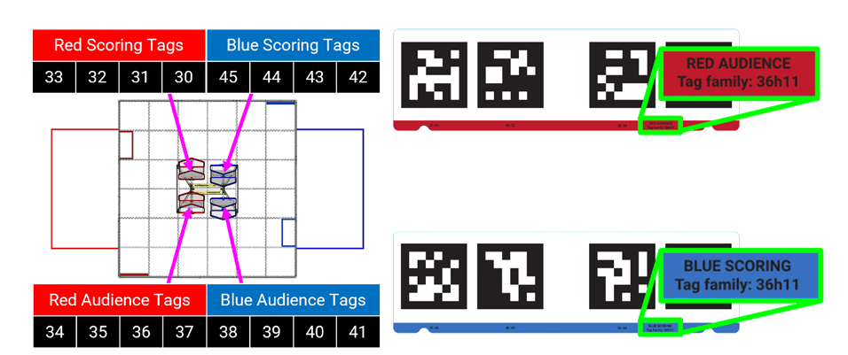
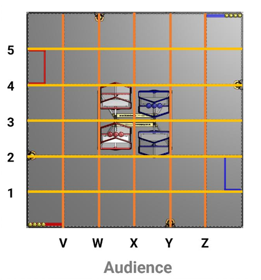

# Context for AI assistants

Read this first when working in this repo. It records the game, the robot, the team's strategy, and how the
code fits together, so a new session doesn't have to rediscover them. **Keep it current:** when you change
hardware names, mechanisms, controls, architecture, or learn a new game fact, update the matching section.

Last full review: 2026-11-07, against `feature/Shooting` (`ad5d77c`), with drive code from `dev` (`53538c1`).
`dev` was merged into `feature/Shooting` on 2026-11-10 (merge commit `0251b8c`); see section 13.

---

## 1. Team and season

- **Team:** Terabridges, FTC team **18603**.
- **Season:** **BIOBUZZ** (2026–2027). Kickoff was September 12, 2026.
- **This repo** (`C:\Code\2026_BioBuzz2`) is the current season's robot code.
- **Last season's repo** (`C:\Code\2025-decode`, DECODE 2025–2026) is for reference only. DECODE also used
  ~3 in. balls (Artifacts) with a shooter and turret, so its patterns can help. Don't edit it unless asked.
- How the user wants things explained can change from session to session; they'll say. They usually build
  big features step by step, so implement only the piece asked for.

## 2. The game (BIOBUZZ presented by RTX)

BIOBUZZ is part of the FIRST CANOPY season, with a bee-and-pollination theme. The user supplied this summary on
2026-11-07, compiled from a Competition Manual excerpt (Section 8, Game Overview V1) and secondary sources
(Studica, league recaps). **FIRST changes the rules through Team Updates, so check the latest Competition
Manual before relying on exact points or rule wording.**

### Alliances, elements, and match timeline

- Two alliances of two teams each.
- **Pollen:** 40 per match, plastic balls about 3 in. across, similar to DECODE Artifacts. Either alliance
  can score them.
- **Nectar:** 8 red and 8 blue per match, alliance-colored balls. The Limelight detector classes
  `red nectar` and `blue nectar` (`DetectedBall.BallType.RED/BLUE`) are these.
- **Timeline:** 30 s autonomous, then an 8 s transition, then 2:00 driver-controlled. The last 60 s
  is when the Flowers open.

### Field elements

Field diagrams from the user (2026-11-08): the AprilTag layout by Cell, and the tile grid seen from the
audience (bottom). Each tile is 24 in.





- **Hives: one per alliance** (corrected by the user on 2026-11-08; an earlier note said four). Each is a
  **two-Cell hive on a pivot** at the field center: in the field diagram, the two red shapes are the two Cells
  of the red hive, and the two blue shapes are the Cells of the blue hive. Robots launch elements into the
  **upward-facing Cell**. When enough weight lands, the hive **tips**, which flips it so the other Cell faces
  up, and the cycle repeats. **Launching into the upward Cell is the only legal way to tip a hive.**
  - **8 Pollen tips a hive.** Nectar adds weight too, so a mix of Pollen and Nectar can also tip it. We only
    shoot Pollen, so plan on 8 Pollen per tip, which is two full loads of 4.
  - **Close and far Cells:** a hive's two Cells sit one toward the audience (close) and one away from it (far),
    up/down in the field diagram. Exactly one faces up at a time; tipping swaps them. In the team frame
    (section 8) the two Cells have about the same x and differ in y.
  - **AprilTags: 4 per Cell, 8 per hive, family 36h11.** A Cell's tags are **visible only when that Cell faces
    up** (open). A tipped-down Cell can't be scored, and its tags can't be seen. The SDK puts a cluster's origin
    at the center of the Cell opening. The tags **move** with the hive, so the SDK warns they can't be used for
    field localization.
  - **Tag IDs by Cell** (user's field diagram; matches [huskylens-tags.md](huskylens-tags.md)):

    | Alliance | Far Cell ("scoring" tags) | Close Cell ("audience" tags) |
    | --- | --- | --- |
    | Red (left of center, seen from the audience) | 30–33 | 34–37 |
    | Blue (right of center) | 42–45 | 38–41 |

  - **Field grid:** 6×6 tiles, **24 in. each**. Columns V–Z are the tile seams from the audience's left to
    right; rows 1–5 are the seams from the audience side up. The hives span roughly columns W–Y, rows 2–4.
  - **Red ↔ blue:** blue positions should be red mirrored across x = 72 (`x → 144 − x`,
    `heading → π − heading`, y unchanged), so a close Cell stays close. Confirm against the official field
    drawing before relying on it: the wall zones in the diagram look 180°-rotated instead.
  - Exact field coordinates of the Cells are **not known yet**. Measure the two red Cells and mirror them for
    blue.
  - Each tip unlocks one more Nectar from that alliance's staging area. A human player brings it in through
    the **Loading Zone**, by hand with no tools. Below 60 s, all remaining Nectar can come in at once.
  - When a hive tips, spilled elements must reach the floor before anyone collects them.
- **Flowers (4):** open for scoring in the **final 60 s**. Ownership works like king of the hill: the alliance
  whose Nectar is **top-most** in a Flower owns it and earns points for every Pollen and Nectar in it, no
  matter who placed them. The alliance with the **bottom-most** Nectar gets a 5-point bonus. Elements enter
  only through the top ring. Only Pollen (not Nectar) can be removed from the bottom of the middle ring.
- **Garden:** a lower-value zone worth 1 point per element.
- **Loading Zone:** where the human player feeds in Nectar, and where robots park.
- The auto framework names starting regions **Garden side** and **Loading side** of the alliance wall.
  These are the team's own labels, not official names.

### Scoring

| Action | Points |
| --- | --- |
| Hive tip | **20** |
| Pollen or Nectar left in an upward-facing Cell at match end | 2 each |
| Pollen or Nectar in an owned Flower | 2 each |
| Bottom-Nectar bonus in a Flower | 5 |
| Pollen or Nectar in the Garden | 1 each |
| Leave (auto) | 3 |
| Park in the Loading Zone (end of auto, and again at end of match) | 5 each time |

### Ranking points

- Win: 3 RP. Tie: 1 RP.
- **Pollinator RP:** 1 RP for **4 hive tips**, and a second RP for **7 tips**.
- 1 RP for **16 combined leave and park points** across the alliance.

### Rules that shape our code

- **A robot can control at most 4 scoring elements at once.** Hoarding to deny opponents is a major foul.
  `Spinner`'s ball count is clamped to 0–4, so intake logic should stop or refuse a 5th ball.
- Nectar entering a Flower before the last 60 s is a major foul per element.
- In auto, robots can use sensors to collect Pollen (including from Flowers) and launch into their hive.

## 3. Strategy

- **The only way we score is by shooting Pollen to tip the hive.** The robot picks up Pollen and shoots it.
  Don't propose mechanisms, autos, or features for other scoring methods unless asked. Most of a match is a
  launching race for tips, and tips also drive the Pollinator RPs (4 and 7 tips).
- Points we can still get without other mechanisms: leave in auto (3), park in the Loading Zone at the end of
  auto and of the match (5 each), and Pollen left in our upward-facing Cell at the end (2 each).
- **Shoot only at our own alliance's hive, never the other alliance's** (user, 2026-11-08).
- **Shoot only at the open (upward-facing) Cell.** You can't shoot into a Cell that's tipped down. The open
  Cell swaps between close and far after each tip, so the turret has to know which Cell is up and aim there.
- **Turret aiming uses odometry, not vision.** The Pinpoint always knows the robot's field pose, and the
  turret angle is computed from that pose and the hive's location. The math is in `TurretAim` (section 8,
  Turret), but nothing drives the turret with it yet: today the turret is only driven by hand with the bumpers.
- **Which Cell to aim at depends on which half of the field the robot is on** (user, 2026-11-08): you can't
  shoot the far Cell from the audience half or the close Cell from the far half, so the aim switches at
  y = 72 (with a band) **even if that Cell is tipped down**. This is mostly for auto.
- **The HuskyLens tells us which Cell is open** (mostly an auto feature; the user doesn't plan to use it in
  TeleOp). A Cell's 4 AprilTags are only visible when it faces up, so
  if the HuskyLens sees a Cell's tags, that Cell is open and is the target. The odometry aim point is that
  Cell's field position. The HuskyLens picks the target; it does **not** steer the turret directly.
- **The Limelight is for finding Pollen** on the floor (neural detector), for auto-intake and driving to
  Pollen.

## 4. Repo, branches, and workflow

- **Git flow:** `feature/*` → `dev` → `main`. Do work on a feature branch, merge it into `dev` with a PR, and
  only merge `dev` into `main` when it's competition-ready.
- **Never commit or push unless the user asks.** Never add Claude co-author or "Generated with" lines to
  commits or PRs.
- The user mostly works on **`feature/Shooting`**. `dev` was merged into it on 2026-11-10 (see section 13).
- Other remotes: `upstream` is the official FtcRobotController, and Pedro Quickstart history is merged in.
- Branch names you'll see: `feature/AutoIntake`, `feature/AutoSetup`, `feature/intakeSensors`,
  `feature/huskylens`, `feature/teleOpWork2`, `feature/summerBot`, and others.

### Build, deploy, and tests

- Android Studio / Gradle project. Team code lives in the `TeamCode` module. **Don't edit
  `FtcRobotController/`.** Copy samples out of it instead.
- **FTC SDK 12.0.0** (see `build.dependencies.gradle`). Gradle 9 / AGP 8.13.
- **Deploy with Sloth hot reload:** the `deploySloth` task. When it finishes, `pushRobotConfigXml` runs and
  pushes `TeamCode/src/main/res/xml/ivy_config.xml` to `/sdcard/FIRST/` on the Control Hub through `adb`.
- **Unit tests** are local JVM tests in `TeamCode/src/test/java`:

  ```bash
  ./gradlew :TeamCode:testDebugUnitTest
  ```

  `returnDefaultValues = true` stubs out android.* calls. The tests cover Rates, the auto framework,
  FollowerManager handoff, and mechanism stop/shutdown, plus the drive backends and DriveControl.
- **CI:** `.github/workflows/tests.yml` runs the unit tests on every PR, and on pushes to `master`. This
  repo uses `main`, so the push trigger never fires. The other workflows (mistake-PR, reopen) only run in
  `Pedro-Pathing/Quickstart` and do nothing here.

### Libraries

| Library | Used for |
| --- | --- |
| Pedro Pathing (`revhub` 3.0.1, `tuning` 1.0.1) | Follower, Pinpoint localizer, mecanum drivetrain, **Foresight** path-following algorithm, autotuners |
| FTCLib core 2.1.1 | `PIDFController` for the flywheel |
| Panels / Sloth (`com.bylazar`, `dev.frozenmilk`) | `@Configurable` live-tunable `public static` fields, `JoinedTelemetry` (Panels + Driver Station), hot reload |
| PsiKit 0.2.0 (`org.psilynx.psikit`) | `Logger.recordOutput(key, value)` logging (AdvantageScope style) |
| StateFactory 0.3.9 | State machine library. Imported but not used yet |

Pedro's API here is the newer 3.x style: `follower.pose()`, `follower.manual(...)`, `ManualDrive.fieldCentric`,
`ManualDrive.driveOrHold`, `Pose.zero()`, and `pose.x()/y()/heading()` as methods. Older Pedro examples use
different names (`getPose()`, `setTeleOpDrive`), so check before copying them.

## 5. Hardware map (`ivy_config.xml`, robot "Ivy")

Use these exact names in `hardwareMap.get(...)`. This table is from `feature/Shooting`.

| Name | Type | Hub / port | Owner class |
| --- | --- | --- | --- |
| `front_left` | goBILDA motor | Expansion 0 | drive |
| `back_left` | goBILDA motor | Expansion 1 | drive |
| `front_right` | goBILDA motor | Control 0 | drive |
| `back_right` | goBILDA motor | Control 1 | drive |
| `transfer` | goBILDA motor | Expansion 2 | `Transfer` |
| `spinner` | goBILDA motor | Control 2 | `Spinner` (intake roller) |
| `flywheel` | goBILDA motor | Control 3 | `Shooter` |
| `ramp_left`, `ramp_right` | servos | Control 0, 1 | `Ramp` |
| `turret_left`, `turret_right` | servos (paired) | Control 2, 3 | `Turret` |
| `blocker` | servo | Control 4 | `Transfer` |
| `hood` | servo | Control 5 | `Shooter` |
| `light_left`, `light_right` | servo-driven lights | Expansion 0, 1 | `Lights` |
| `distance_1`..`distance_4` | digital (beam-break style) | Expansion 1, 3, 5, 7 | `Spinner` |
| `turret_left_analog` | analog input (servo encoder) | Expansion analog 0 | `Turret` |
| `pinpoint` | goBILDA Pinpoint | Control I2C 1 (confirmed; XML `bus="1"`) | Pedro localizer, field-centric heading |
| `limelight` | Limelight 3A (Ethernet over USB) | — | `Vision` |
| `huskylens` | HuskyLens (I2C) | **not in the XML** | `Vision`, loaded with `tryGet`, so it's optional |

**The flywheel is two motors wired to the same port** (Control 3), so the config and code have one `flywheel`. The
Pinpoint is on I2C port 1 (from `dev`'s XML).
`summerbot_config.xml` is for the old summer test bot (different motor names). Don't use it.

## 6. Code layout

Package root: `TeamCode/src/main/java/org/firstinspires/ftc/teamcode/` (layout rules are in
[teamcodeOrganization.md](teamcodeOrganization.md)).

```text
actions/       Action interface (start/update/isFinished/stop), nonblocking; StateMachines.java is an empty stub
autonomous/
  framework/   AutoCatalog, AutoMenu, AutoConfig, AutoContext, AutoRoutine, Alliance, StartSide
  paths/       FieldPoses (only TEST_START so far); path classes go here
  routines/    DoNothingRoutine (the only routine so far)
config/        empty for now; meant for robot-wide names, limits, and setpoints
control/       gamepad → subsystem mapping, one Control per mechanism (drive, intake, outtake, vision)
opmodes/
  teleop/      MainTeleOp
  autonomous/  BaseAutoOpMode, SelectableAutoOpMode, SelectableAuto ("Auto Select")
  tests/       calibration and diagnostic OpModes
pedro/         Constants (follower config), FollowerManager, Tuning plus autotune procedures
subsystems/    Robot, Subsystem, and drive/, intake/, outtake/, vision/
utility/       Utility.clamp, EdgeDetector, AbsoluteAnalogEncoder, driveUtility/ (Rates, PoseLogging), visionUtility/
```

## 7. Architecture and conventions

- **`Subsystem` interface:** `init()`, `update()`, and the defaults `stop()` and `logPsiKitData()`.
- **Pending-write pattern:** public methods (`setRampPos`, `openBlocker`, `setTargetRPM`, `turnTurretLeft`,
  and so on) only store a target and maybe set a `...Changed` flag. **Hardware is written only in
  `update()`.** Servos are written only when their value changed, to save loop time. Follow this pattern in
  new subsystems.
- **`Robot`** holds `intake`, `outtake`, `vision` and calls `init/update/stop/logPsiKitData` on all of them.
  `Intake` = `Ramp` + `Spinner` + `Transfer`. `Outtake` = `Shooter` + `Turret` + `Lights`.
  Call `robot.toInit()` at **Start**, not at Init, so nothing moves during Init.
- **`Control` classes** (`update()`, `addTelemetry(t)`) turn gamepad input into subsystem commands.
  OpModes stay thin: build `Robot`, build the Controls, then loop `controls → robot.update() → drive`.
- **Buttons** use `EdgeDetector`, which fires a `Runnable` on the rising (or falling) edge. It's a
  `Consumer<Boolean>` with optional rising and falling Runnables, `update(boolean)` (same as `accept`), and
  public `wasPressed`. `OuttakeControl` uses a `connect(supplier, runnable)` list.
- **Stopping safely:** `stop()` methods use `try/finally` so one failing motor doesn't stop the others
  from being zeroed. OpModes catch `RuntimeException` in `start/loop`, call `stop()`, and rethrow.
- **Tunable values:** `@Configurable` classes expose `public static` fields to Panels. Static fields
  **persist between OpModes** in the same app session. For example, `Shooter.stop()` deliberately resets
  `flywheelTargetRPM` for this reason.
- **`Vision` is a singleton** (`Vision.getInstance(hardwareMap)`, a static instance). It keeps the first
  `HardwareMap` it was given.
- Code style: sections marked `//---------------- Hardware ----------------` and so on, with private
  "core" methods that write hardware. Comments explain units and *why*.

## 8. Mechanisms

### Drive

- **`Drive` interface:** `robotCentric(forward, right, turn)` and `fieldCentric(...)`. **Positive values
  mean forward, right, and clockwise.**
- **`DriveManager(Backend.DIRECT | Backend.PEDRO)`** owns one drivetrain per OpMode.
  `start(map, resumeFromAuto)` → `update()` → `stop()`. The `drive()` method returns the active `Drive`.
  - `DirectDrive` mixes mecanum wheel powers itself. Field-centric reads only the Pinpoint heading.
  - `PedroDrive` sends `follower.manual(...)`. Pedro's convention is **left and counterclockwise
    positive**, so `PedroDrive` negates `right` and `turn`. It also has `driveOrHold*`, which holds position
    when the sticks are released.
- **`DriveControl`** runs the sticks through `Rates` (Betaflight-style expo curve; center rate 0.7, expo 0.4,
  turn center 0.375, deadzone 0.01). Left stick moves, right stick X turns, B toggles slow mode (×0.5),
  and Back toggles field-centric.
- `MainTeleOp` uses the `PEDRO` backend, rates on, robot-centric at start, and resumes the
  autonomous pose.
- `Robot` doesn't own a drive any more (only the `(HardwareMap, Telemetry)` constructor). The old `Drive`
  subsystem class and `Drive2_0` are gone.
- The **Shot Data Collector** doesn't use `DriveManager`: it keeps its own `FollowerManager` (so it can set
  a start pose) and drives through `new PedroDrive(follower)` with `DriveControl(drive, gamepad1, true, false)`,
  the same pattern as `IntakeDriveHoldTest`.
- Motor directions: left side FORWARD, right side REVERSE, brake mode.

### Pedro and localization (`pedro/`)

- `Constants.create(hardwareMap)` builds a `Follower(PinpointLocalizer, Mecanum, Foresight)`.
  Pinpoint pod offsets are x -6.34 in. and y -2.60 in., goBILDA 4-bar pods, both pods reversed, units in
  inches. The Foresight gains and max velocities (forward about 84.9 in/s, strafe about 69.0 in/s) come from
  the autotuner.
- **`FollowerManager`** is the only class that updates or stops a follower. When a competition auto
  stops cleanly it calls `handoffToTeleOp()`. TeleOp then calls `FollowerManager.forTeleOp(map)`, which
  takes that follower (and its pose) once, if the `HardwareMap` matches, and restores the motor settings.
  Otherwise it creates a fresh follower. Init-only runs, failed runs, and path tests never hand off.
- **Team field frame (Pedro, agreed 2026-11-08):** inches on a 0–144 field, heading in radians,
  counterclockwise positive, 0 = +x. **(0, 0) is the audience-side corner on the left (seen from the audience);
  +x runs right along the audience wall and +y runs away from the audience.** This is Pedro's usual
  orientation. The diagram's grid lines map as V/W/X/Y/Z → x = 24/48/72/96/120 and rows 1–5 → y = 24…120, so
  the field center is (72, 72). Pedro itself only tracks movement from `setStartingPose`, so start poses,
  Cell positions, and pose-reset spots must all use this frame.
  `PoseLogging.toPose2dFromPedroInchesAsFtcCenterRotated` converts them to FTC center-origin meters for
  logging (`ftcX = 72 − pedroY`, `ftcY = pedroX − 72`, heading + 90°). That formula came over from DECODE and
  hasn't been checked against BIOBUZZ's official field coordinate system.
- Tuners are in `pedro/Tuning.java` (`@Tuner` procedures: mecanum, pinpoint, foresight, tests).

### Intake: `Ramp`, `Spinner`, `Transfer`

- **Spinner** (`spinner` motor, REVERSE, no encoder, float): the intake roller. In = +0.98 and out = -0.98.
  It can also be set to a variable power.
- **Ramp** (two servos, left reversed, right = left + 0.024): down 0.47 and up 0.73, clamped to 0.47–0.774.
  `init()` puts it **up**. A toggles it.
- **Transfer** (`transfer` motor, forward, no encoder, float; default power 1.0) moves Pollen to the
  shooter. **Blocker** servo: closed 0.52 and open 0.62 (clamped 0.52–0.66). `init()` closes it.
  The blocker holds Pollen back from the flywheel.
- `Intake.intakeIn(pow)` / `intakeOut(pow)` run the spinner and transfer together.
- **Beam sensors and ball count (from `feature/intakeSensors`, via `dev`):** `distance_1`..`distance_4`,
  where active-low means "broken". Sensor 1 is the entry and sensor 4 is the last one before the shooter.
  `Spinner.updateBallCount()` adds one on sensor 1's rising edge while intaking. It subtracts one on sensor 4's
  falling edge while intaking (ball shot), or on sensor 1's falling edge while reversing (ball ejected).
  The count is clamped to 0–4, so the robot holds up to 4 Pollen. `setBallCount(n)` is for auto preloads.
- **Planned transfer behavior** (`TeamCode/doc/plan.md`): when not shooting, run the
  transfer at 30%. The transfer pushes only the last ball (the next to be shot). While the last sensor is
  clear, run intake and transfer at 30%. Once it trips, stop the transfer until the shot.
- **Single-shot mode (`IntakeControl`):** gamepad 2 B switches between manual triggers and
  single-shot. In single-shot, gamepad 2 X opens the blocker and runs the spinner. When the ball clears
  sensor 4, it closes the blocker and runs a reverse pulse (-0.3 for 80 ms) to separate the trailing ball.

### Shooter (`Shooter`, `@Configurable`)

- **Two flywheel motors on one port** (confirmed by the user): they're wired together to Control Hub port 3,
  so in code it's one `flywheel` (FORWARD, `RUN_WITHOUT_ENCODER`, float). Both motors still drive the
  flywheel, so it has the same power as before the config change. Only one encoder can plug into the port,
  so RPM comes from that motor's encoder. 28 ticks/rev, 1:1 gearing. Both motors must spin the same way
  when given the same power (set by wiring/mounting, not code), and they share the port's current limit.
  `FlywheelEncoderDiagnostic` and `FlywheelVelocityTest` jog the flywheel at 0.15 power while RB is held.
- **Velocity control:** FTCLib `PIDFController` on RPM. The gains are `p=0.0014`,
  `i=0.00008`, `d=0`, `f=0.000213` (dev's Oct 25 tune). Output is clamped to 0–1, so the flywheel never runs in reverse. A target
  of 0 or less resets the PID and sends 0 power.
- `shootRPM` (default 2000, step 100, max 6000) is the "shooting" speed. `toggleShooting()` switches the
  target between 0 and `shootRPM`. Changing `shootRPM` while shooting applies right away.
- **Hood** servo: 0.39–0.82, step 0.02, nominal start 0.5. The hood isn't written at init.
  TODO in the code: check that a higher position raises the hood.
- **Shot tables: `utility/shooterUtility/ShooterData`** (FTCLib `InterpLUT`, distance in inches → RPM and →
  hood position, via `getRPMVal`/`getAngleVal`). Copied in layout from the 2025 `ShooterData` (repo
  `Terabridges/2025_Decode`, branch `VF3LIX`, minus the shot-time table). **Six measured rows** (2026-11-10,
  `shotData_20261110_193002.csv`, odometry distance, PIDF f 0.000213):

  | Distance (in.) | 17.9 | 28.8 | 34.7 | 40.4 | 49.1 | 55.2 |
  |---|---|---|---|---|---|---|
  | RPM | 1970 | 2000 | 2060 | 2100 | 2130 (measured 2120, bumped +10) | 2190 |
  | Hood | 0.430 | 0.560 | 0.700 | 0.780 | 0.820 | 0.820 |

  End rows at 0 and 1000 in. **repeat the nearest measured row** (1970/0.430 and 2190/0.820), so outside
  17.9–55.2 in. the tables hold flat instead of bending toward made-up values. Hood 0.820 is `Shooter`'s
  `hoodMax`, so past about 49 in. the hood is at its limit and only RPM rises. `InterpLUT.get()` throws at or
  past the end rows, so the getters return `INVALID` (-2) outside 0 < d < 1000. Nothing calls it yet. Fill it with the **Shot Data Collector** OpMode:
  distance from `TurretAim` (odometry) or a Panels `manualDistance` override; RB fires one ball (open blocker +
  intake for `feedTimeMs`, only when RPM is within `readyTolerance`); Y saves, **gamepad 2 LB** deletes the last row; X
  switches the turret between locked forward and tracking; **B switches alliance during the run** (init: X blue,
  B red). Because B is taken, this OpMode overrides `DriveControl.updateButtons()` so only Back (field-centric)
  works: **no slow mode here**. Each CSV row records the alliance it was saved with. No beam sensors on this
  branch, so a shot is timed.
  Unless autonomous handed off a pose, it sets the pose at Start to **(7.58, 8.19) heading 90°**: robot in
  the audience-left corner, back to the audience wall, facing away from the audience (half the width in x,
  half the length in y). `startX/startY/startHeadingDeg` are Panels values.

### Turret (`Turret`)

- **Two paired continuous-position servos**, `turret_left` and `turret_right`, on the **same gear**.
  Right command = left + `rightTurretOffset` (-0.008). The PWM range is extended to **500–2500 µs**, with
  positions 0–1 clamped so both commands stay in range.
- **Gearing:** servo 0–1 is one full servo turn (360°), which is **480° of turret** through 3:4 gears.
- **Wrap danger:** the servo takes the shortest way to a new position. If the command gets 0.5 or more
  ahead of the real servo, it spins the wrong way across 0/1. So **every move is rate-limited**: `update()`
  steps `turretCurrentPos` toward the target at `turretVel` servo units/s (default 0.5, manual 0.3).
  `init()` is the one direct write, to 0.5, because the real position at startup is unknown.
- API: `moveTurret(pos[, vel])`, `setTurretVel(vel)` (where 0 stops), `turnTurretLeft/Right()`,
  `stopTurret()`, `aimAt(angleRad)`, `getTurretPos()`, `getTurretTargetPos()`, `isTurretAtTarget()`.
- **`aimAt(angleRad)`** (call every loop while tracking): angle from the robot's front, counterclockwise
  positive. 0.5 points straight back, so `positionFor` first measures the angle from straight back
  (`wrap(angle − 180°)`), then servo position = `0.5 + turretDirection · thatDeg / 480`. Forward (0°) is
  0.125 or 0.875. Within about 60° of straight forward there are two positions a full
  turn (0.75) apart that point the same way; `positionFor(angle, fromPos)` takes the in-range one closer to
  the current position, so the turret only swings around when it hits the end of its range. The move still
  goes through `moveTurret`, so it stays rate-limited. `turretDirection` (+1) is unverified, like the
  velocity sign.
- `turret_left_analog` is read through `AbsoluteAnalogEncoder` (0–3.3 V → 0–360°), but **Turret doesn't use
  it in control yet**.
- **At servo position 0.5 the turret points straight back** (the user corrected an earlier note that said
  forward). `init()` moves it there. In code: `turretStartAngleDeg = 180`.
- **Range: the full 0–1 servo range is used on purpose** (confirmed by the user). That's about 480° of
  turret, so it covers more than a full circle. For some headings there are two servo positions that point
  the same way; aiming code should pick the one closer to the current position.
- TODOs in the code: measure the real top speed, and confirm that positive velocity means counterclockwise.
- **`utility/shooterUtility/TurretAim`** (pure math, no hardware): `update(pose)` once per
  loop, then `getTurretAngle()` (radians from the robot's front, counterclockwise positive, (-π, π]),
  `getDistance()` (turret pivot → Cell, inches, the `ShooterData` input), and `getCell()`. It picks the close
  or far Cell from the robot's y with a hysteresis band (`cellSwitchY` 72, `cellSwitchBand` 6), mirrors red
  Cell positions for blue (`144 − x`), and adds the turret pivot offset rotated by heading. The robot spins
  about its center (the Pedro pose). **Robot: 416 mm long × 385 mm wide** (16.4 × 15.2 in.). The turret
  center is 189 mm from the back, so **19 mm (0.748 in.) behind the robot's center, centered side to side**
  (`turretOffsetForward = −19/25.4`, `turretOffsetLeft = 0`). **Red close Cell measured at (56.8, 50.7)**;
  red far Cell (56.8, 93.3) is the close Cell mirrored across y = 72 (the hive's tilt line), not measured
  yet. All are `@Configurable`. Not wired up yet:
  the OpMode still needs to call `turretAim.update(pose)` and `turret.aimAt(turretAim.getTurretAngle())`. MainTeleOp still starts at (0, 0, 0) without autonomous; the Shot Data Collector has a corner start pose.
- Assembly and calibration: [turret-servo-assembly-aligner.md](turret-servo-assembly-aligner.md). That
  OpMode uses the older device names `turretL`, `turretR`, `floodgate`, and `turretAnalog`. Check those
  against the XML before running it.

### Lights

- `light_left` and `light_right` are servo-PWM lights (`setLights(pos)`). They aren't wired to any
  behavior yet: `OuttakeControl.updateLights()` is empty.

### Vision (`Vision`, singleton)

- **Limelight 3A**, pipeline 0. `hasTarget()`, `getTx()/getTy()` (uncropped, `NC`), `getArea()`,
  `getCurrentTagId()`, and detector results.
- **Pollen location:** each detector result's pixel center goes through a **homography** to a robot-relative
  offset (inches), which is then rotated by heading and added to the robot pose. `Cluster` groups balls
  within 0.5 units and scores each cluster by the sum of its confidences. `getBestClusterPose(robotPose,
  offsetInches)` returns an approach pose facing the best cluster.
  - This is in `DetectedBall(LLResultTypes.DetectorResult, Pose)` (from `dev`). Before the merge,
    `feature/Shooting` had the math in `Vision` (camera height 6.97 in., pitch 20°, forward offset 4.72 in.,
    Pollen height 2.86 in., 50 ms look-ahead velocity prediction).
  - Open TODO: driving straight to Pollen may be blocked, and starting a new path over a running one could
    be dangerous.
- **HuskyLens** (optional) runs `TAG_RECOGNITION`. **It uses learned IDs 1–16, not the printed AprilTag
  numbers.** The mapping is in [huskylens-tags.md](huskylens-tags.md); for example, learned ID 1 is tag 42.
  Its purpose is to **detect which side of the hive is open**.
- `VisionSnapshotCollector` (a test OpMode) captures images for training the Limelight model.

## 9. Driver controls (`MainTeleOp`, from code)

**Controls are a work in progress for both gamepads** (the user is still designing gamepad 1, and gamepad 2
isn't planned yet). Treat the mappings below as the current code, not a final layout, and ask before
assigning buttons. [gamepadControls.md](gamepadControls.md) is the team's control sheet (V1, a blank V2
draft, and a blank gamepad 2).

**Gamepad 1**

| Input | Action |
| --- | --- |
| Left stick | Drive (forward/strafe) |
| Right stick X | Turn |
| B | Toggle slow mode |
| Back | Toggle field-centric |
| A | Toggle ramp |
| Y | Toggle blocker |
| X | Toggle shooter (0 ↔ `shootRPM`) |
| D-pad right / left | `shootRPM` +100 / -100 |
| D-pad up / down | Hood up / down |
| LB / RB (held) | Turret left (CCW) / right (CW). Both or neither stops it |
| RT / LT | Intake in / out (spinner + transfer). Power follows the trigger, clamped to 0.5–0.98 |

**Gamepad 2:** not built yet. B switches between manual and single-shot mode, and X fires a
single shot. These are temporary.

### Planned layout (decided 2026-11-07, buttons not assigned yet)

The goal is a minimal driver layout, with automation doing the rest and gamepad 2 holding the backups.

- **Gamepad 1 (main driver):** drive (sticks), intake (trigger), **toggle shoot**, **toggle ramp**, plus an
  outtake/eject for jams or an accidental 5th ball. While shooting is on, the robot should handle everything
  else: the turret aims from odometry at the open Cell, RPM and hood come from distance, the transfer feeds
  using the beam sensors, and the intake stops at 4 Pollen.
- **Gamepad 2 (backups):**
  - **Reset pose** buttons, to re-zero odometry at known field spots when the pose drifts or the robot
    gets hit. Aiming depends on the pose.
  - **Manual override for which Cell is up (close or far)**, for when the HuskyLens can't see the tags.
  - **Small trims** for aim and shot (turret angle, RPM, hood), for when shots land a bit off.
- The current manual turret, RPM, and hood buttons on gamepad 1 are there only until that automation
  exists.

**Auto Select menu (before Start):** D-pad up/down browses, A enters or confirms, B goes back.

## 10. Autonomous framework

- **Entry points:** "Auto Select" (competition) and "Auto Path Test". Both use the same `AutoCatalog`.
  Path Test runs the paths but skips mechanism actions, and never builds `Robot`.
- **Selection** goes alliance → side (Garden/Loading) → routine. `AutoConfig` holds the name, alliance,
  side, and **measured start pose**. Alliance isn't mirrored automatically: every entry needs its own
  correct pose.
- **`AutoRoutine`:** `start/update/stop`, `result()` (READY/RUNNING/SUCCEEDED/TIMED_OUT/CANCELLED), and
  `state()`. It's nonblocking. **Routines must not call `follower.update()` or `robot.update()`**, because
  `BaseAutoOpMode` does that.
- Mechanism behavior goes through `context.mechanismAction(robot -> new SomeAction(...))`, so Path Test can
  replace it with an action that finishes immediately. Register routines that use mechanisms with
  `requiresRobot = true`.
- **Current state:** only `DoNothingRoutine` is registered (for all 4 alliance/side combinations).
  `FieldPoses` has only `TEST_START = Pose.zero()`. No field poses have been measured yet.
- To add an auto: measure the start pose and add it to `FieldPoses`, add a paths class (group related
  paths), add a routine with its own state machine and timeouts, then register it in `AutoCatalog.ENTRIES`.

## 11. Test and calibration OpModes (`opmodes/tests`)

| Driver Station name | Purpose |
| --- | --- |
| ShooterTunerPIDF | Tune flywheel PIDF live with Panels |
| Flywheel Raw Encoder Test / Flywheel Encoder Diagnostic | Check flywheel encoder and velocity |
| TurretServoAssemblyAligner / TurretServoVerifier | Mesh the paired turret servos and find `rightOffset` |
| ServoLimitFinder / SETSERVO | Find servo limits and set default positions |
| Vision Snapshot Collector | Collect Limelight training images |
| Shot Data Collector | Fill `ShooterData`: tune RPM/hood per distance, fire single shots, save rows (telemetry paste lines + `/sdcard/FIRST/shotData/shotData_<time>.csv`) |
| Test Shot | Test `ShooterData`: same as the Shot Data Collector (drive, alliance on B, turret toggle on X, RB fires one ball when READY), but RPM and hood come from the tables for the current distance every loop, and nothing is saved. Hood is only rewritten when the table value moves more than 0.002. Out-of-range distance (INVALID) holds the flywheel off |
| MainTestTeleOp | Near-empty scratch TeleOp |
| IntakeDriveHoldTest | Intake with drive-or-hold (was `IntakePlusPredictiveTrackingTeleop`) |
| Drive Comparison Test | Compare DIRECT and PEDRO drive, toggle rates |
| Auto Path Test | Run auto paths without mechanisms |

## 12. Logging and telemetry

- TeleOp sends telemetry to both Panels and the Driver Station through `JoinedTelemetry`, at about 5 Hz
  (every 200 ms) to keep loops fast.
- PsiKit `Logger.recordOutput` keys include the shooter's target and current RPM, vision tx/ty/area, and
  `PoseLogging`'s `Pinpoint/*` and `Localization/*`.
- `MainTeleOp` also reports loop, drive, and mechanism times (current and max, in ms).

## 13. Merge of `dev` into `feature/Shooting` (2026-11-10)

`origin/dev` (`53538c1`) was merged into `feature/Shooting` as `0251b8c`. The user asked to **keep this
branch's shooter behavior**, so where the two differed:

- **Shooter:** kept this branch's **`RUN_WITHOUT_ENCODER`** (the PIDF controls speed, so the hub's own
  velocity loop shouldn't run on top). `dev` had `RUN_USING_ENCODER`. **PIDF is `dev`'s newer one:
  p 0.0014, i 0.00008, d 0, f 0.000213** (tuned Oct 25 with both motors on one port; the user chose it after the merge,
  replacing this branch's f 0.00023). **Direction is FORWARD** (the user's call after the merge, same as
  `dev`). Kept `dev`'s `getFlywheelVel()` because `OuttakeControl` logs it.
- **MechanismLifecycleTest:** kept this branch's flywheel-failure test (renamed for the single `flywheel` name); `dev` had
  deleted it.
- **Drive.java:** took `dev`'s (this branch only removed a blank line).
- **ivy_config.xml:** `dev`'s single `flywheel`. The Pinpoint is physically on **I2C port 1** (confirmed by the
  user). PR #12 (`156f204`, Oct 29) tried to move it there with `port="1" bus="0"`, but **in the FTC config XML
  `bus` is the physical I2C port and `port` is only the device's slot on that bus** (checked in RobotCore 12.0.0
  `LynxI2cDeviceConfiguration`: `bus` defaults to `port` only when missing). So that line still meant I2C 0, and
  the robot showed "error communicating with pinpoint". Fixed to `port="0" bus="1"` on 2026-11-10.
  `deploySloth` pushes this XML to the Control Hub, so a wrong bus means Pedro can't reach the Pinpoint.
  `summerbot_config.xml` has the same `port="1" bus="0"` line (not changed; different robot).
- **Shot Data Collector** was updated for `dev`'s new `Robot` and `DriveControl` (see "Drive").
- Everything else came from `dev` as is: `DriveManager`/`DirectDrive`/`PedroDrive`, the `EdgeDetector`
  API, `OuttakeControl` (same buttons, now a `connect` list, plus PsiKit logging), beam sensors / ball count /
  single-shot mode, and the Pollen math in `DetectedBall`.

## 14. Known gaps and TODOs

- Turret auto-aim math exists (`TurretAim`) but isn't connected to the turret; the red far Cell position is mirrored from the close Cell, not measured (close Cell and turret offset are measured); and the `ShooterData` tables only cover 17.9–55.2 in. (six rows).
- Nothing reads HuskyLens results in game logic yet (open/flipped hive side).
- No real autonomous routines or measured field poses.
- Turret: top speed and direction sign are unverified, and the analog encoder isn't used.
- Gamepad 1 and gamepad 2 layouts aren't finished.
- Hood direction is unverified. Lights aren't used.
- `config/` is empty, and the tuning constants are scattered across subsystems.
- `actions/StateMachines.java` is empty, and StateFactory is unused.
- Teach the CI test workflow to trigger on pushes to `main`/`dev` instead of `master`.

## 15. Open questions to ask the team

Record the answers above when you learn them.

- Field layout in the team frame (section 8): the Cell centers (red side; blue is mirrored), the Loading
  Zones, and the starting positions. **The team doesn't know these yet.**
- Exact buttons for the planned layout (section 9), and which known spots the reset-pose buttons use.
